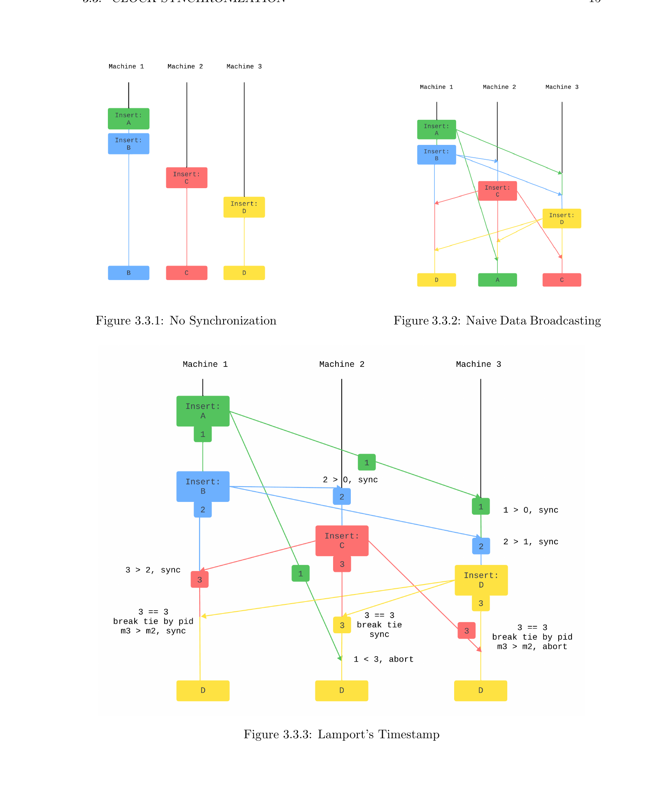
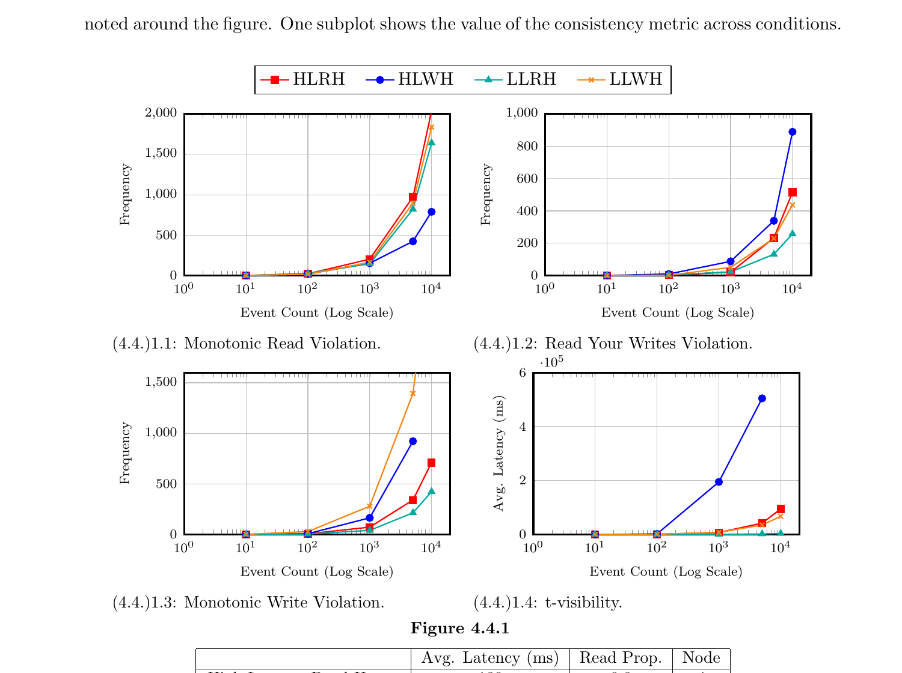
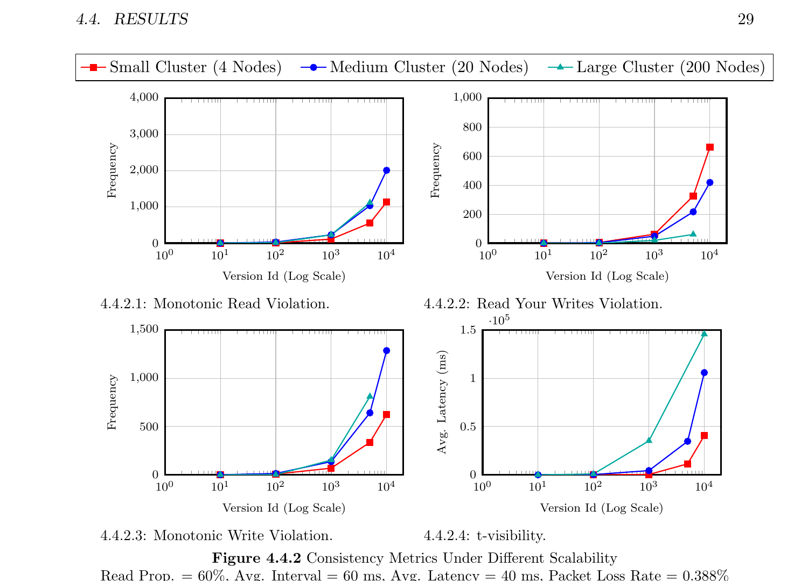
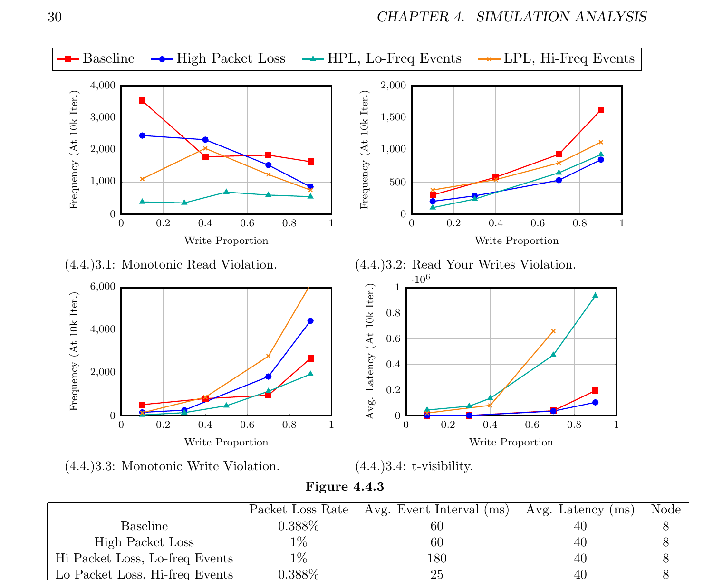

# A Simulation and Evaluation of Distributed Algorithms

> **Bard College Senior Project** | Ziyi Chen | Advisor: Sven Anderson | Dec 2024

<br>

**TL;DR** — A Go-based simulation of a **peer-to-peer distributed storage system** using **Lamport's Logical Clock** for data synchronization. Measures consistency violations under varying latency, scale, packet loss, and workload via four formal metrics. Full paper: [`Bard_Senior_Project_Ziyi_submit.pdf`](Bard_Senior_Project_Ziyi_submit.pdf)

---

## What This Project Does

| | |
|---|---|
| **Simulates** | Peer-to-peer distributed storage — each node is a Go goroutine |
| **Synchronizes** | Data across nodes via Lamport's Timestamp algorithm |
| **Measures** | 4 consistency metrics: MRC, RYWC, MWC, *t*-visibility |
| **Experiments** | Sweeps across latency, cluster size, R/W ratio, packet loss, event frequency |

---

## Quick Start

```shell
cd lamport
go get
go run server.go
```

> Outputs metrics at milestones (10 / 100 / 1K / 5K / 10K events). A live chart is served via HTTP.

---

## Project Structure

```
lamport/
├── server.go                 # Entry point → simulation.Main()
│
├── goclock/                  # Node runtime
│   ├── machine.go            # Machine: goroutine-per-node abstraction
│   ├── factory.go            # MachineFactory: cluster builder
│   └── broker_manager.go     # Wires pub/sub Exchange bindings
│
├── timestamp/                # Clock algorithms
│   ├── lamport_clock.go      # Lamport scalar clock
│   ├── vector_clock.go       # Vector clock (swappable)
│   └── version.go            # Version record (data + ts + source ID)
│
├── exchange/                 # Inter-node messaging
│   └── exchange.go           # Broker with configurable delay & packet loss
│
├── simulation/               # Experiment engine
│   ├── main.go               # Poisson-process event loop
│   └── metrics.go            # MRC / RYWC / MWC / CC metric computation
│
├── chart/                    # Live visualization
│   ├── chart.go              # HTTP chart server
│   └── index.html            # Frontend
│
├── utils/                    # Data structures
│   ├── linklist.go           # Generic linked list (version chains)
│   └── graph.go              # Network topology
│
docker_compose.py             # Generate docker-compose.yml for multi-container runs
connected_graph.py            # Fully-connected topology generator
```

---

## Background (Ch. 2)

### Core Problem

> No global clock exists in distributed systems. Nodes cannot agree on "now".

- **Clock drift** + **random network latency** = impossible to synchronize physical clocks perfectly
- **Logical clocks** replace wall time with a monotonically increasing counter
- Larger counter = newer state

### Consistency Spectrum

```
Weak           Eventual         Causal          Sequential       Linearizable
 (WC)            (EC)            (CC)                              (strongest)
  ◄───────────────────────────────────────────────────────────────────►
                                  ▲
                            This project targets CC
```

| Level | One-liner |
|:------|:----------|
| **WC** — Weak | No ordering guarantee; replicas *might* converge by chance |
| **EC** — Eventual | Without new writes, all replicas eventually converge |
| **CC** — Causal | Causally related ops appear in the same order everywhere |
| **Sequential** | One global sequential order across all processors |
| **Linearizable** | Sequential + real-time bounds (requires global clock) |

### CAP Theorem

> **Consistency + Availability + Partition Tolerance** — pick at most two.

- This project: always-available, partition-tolerant → targets **Causal Consistency** (the strongest feasible level)

### Design Choice: No Leader

- Inspired by **Raft** (used in Redis, etcd) but deliberately avoids leader election
- **Peer-to-peer**: all nodes are symmetric — isolates the synchronization algorithm's effect

---

## Methodology (Ch. 3)

### Node Model

```go
type Machine[T Payload, K ClockDataType] interface {
    Start(); Stop(); Init()
    LocalEvent(event func(data T) T)      // local read/write
    Broadcast(VersionPtr[T, K])            // send sync msg to all peers
    Listen()                               // receive incoming sync msgs
    GetVersionChainData() []T              // read local version chain
}
```

| Property | Detail |
|:---------|:-------|
| **Runtime** | 1 goroutine per node (lightweight, Go-scheduled) |
| **Topology** | Fully-connected graph — every node talks to every other |
| **Storage** | Local version chain (linked list of `(data, timestamp, source_id)`) |
| **Scaling** | Tested up to **200 nodes** in a single simulation |

### Message Passing — Exchange / Broker

- Messages serialized to `[]byte` → transport is payload-agnostic
- **Broker** simulates:
  - **Randomized latency** (Poisson-distributed)
  - **Packet loss** (configurable PLR)
- Go **channels** enable a **Proactor Pattern** — no polling needed
- Design inspired by Python's *celery/kombu*

### Lamport's Timestamp — 4-Step Sync Protocol

| Step | Action |
|:-----|:-------|
| **1** | Node A writes locally, increments timestamp → `ts_A` |
| **2** | Node A **broadcasts** `M = (ts_A, data, node_id_A)` to all peers |
| **3** | Node B receives `M`: if `ts_A > ts_B` → accept & overwrite; if `ts_A < ts_B` → discard; if `ts_A == ts_B` → **tie-break by Node ID** (larger wins) |
| **4** | Node B increments its own timestamp by 1 |

<details>
<summary><b>Diagram: Three synchronization scenarios compared</b></summary>



- **No Sync** (left) → final states: B, C, D — *no convergence*
- **Naive Broadcast** (right top) → final states: D, A, C — *random, Weak Consistency only*
- **Lamport Timestamp** (bottom) → final states: D, D, D — *all converge via timestamp comparison + tie-breaking*

</details>

### Tie-Breaking Rule

> When `ts_A == ts_B`: the node with the **larger Node ID** wins.

- Node IDs are unique positive integers → provides a **transitive global total order**
- Every node independently arrives at the **same decision** without extra communication

### Causal Dependency & Version Chain

- Version chain = linked list encoding the **happens-before** relation (`a → b`)
- New versions are **inserted at the correct position** (by timestamp), not appended
- **Clock Condition C1**: same-node events preserve local order
- **Clock Condition C2**: send event → receive event preserves causal order

---

## Simulation & Metrics (Ch. 4)

### Experiment Parameters

| Parameter | Values |
|:----------|:-------|
| **Cluster size** | 4 / 8 / 20 / 200 nodes |
| **Avg. messaging latency** | 40 ms / 180 ms |
| **Read proportion** | 0.2 → 0.8 |
| **Packet Loss Rate (PLR)** | 0.388% / 1% |
| **Avg. event interval** | 25 ms / 60 ms / 180 ms |
| **Event distribution** | Poisson random process |
| **Event count** | Up to 10,000 per run |

### Consistency Metrics

#### Data-Centric

| Metric | Definition |
|:-------|:-----------|
| ***t*-visibility** | `max(T_read - T_write)` — time until a write is visible on all nodes |

#### Client-Centric (violation counts)

| Metric | Abbreviation | Violation = |
|:-------|:-------------|:------------|
| **Monotonic Read** | MRC | Read returns version *older* than previously observed |
| **Read Your Writes** | RYWC | After writing version *n*, client reads version < *n* |
| **Monotonic Write** | MWC | Version chain has misordering, repeats, or gaps |
| **Write Follows Read** | WFRC | Post-read write executes on a replica older than read version |

> **Ideal baseline** (0 PLR, 0 latency, 4 nodes, 10K events):
> `MRC ≈ 1.9` · `RYWC ≈ 0.7` · `WFRC ≈ 1.1` · `t-vis ≈ 8.3 ms` — near-zero violations confirm at least EC.

---

## Results (Ch. 4.4)

### Experiment 1 — Latency & Read/Write Mix

> 4 nodes · Read Prop ∈ {0.2, 0.8} · Avg. Latency ∈ {40, 180} ms



| Condition | Abbr. | Consistency |
|:----------|:------|:------------|
| Low Latency + Read Heavy | **LLRH** | **Best** across MRC, RYWC, MWC |
| High Latency + Write Heavy | **HLWH** | **Worst** — highest RYWC & *t*-visibility |
| Low Latency + Write Heavy | **LLWH** | Unexpectedly elevated violations (see Discussion) |

---

### Experiment 2 — Scalability

> Read Prop = 60% · Interval = 60 ms · Latency = 40 ms · PLR = 0.388%



- **Small (4) > Medium (20) > Large (200)** in consistency quality for 3/4 metrics
- RYWC anomaly in large clusters: writes are *sparse per node*, so RYWC violations are less likely to trigger — **metric artifact**, not real improvement

---

### Experiment 3 — Write Proportion, Packet Loss, & Event Frequency

> 8 nodes · 4 settings: Baseline / High PLR / High PLR + Low Freq / Low PLR + High Freq



Key takeaways:

- **More writes** → worse RYWC, MWC, *t*-visibility; but *better* MRC (writes overwrite stale state)
- **High event frequency** (25 ms < 40 ms latency) → **drastic** increase in MWC and *t*-visibility
- **Packet loss** (1% vs 0.388%) → **surprisingly little effect** — either below detection threshold or metrics don't capture it well

---

## Discussion & Key Findings (Ch. 5)

| Finding | Detail |
|:--------|:-------|
| **Latency is dominant** | Out-of-order sync msgs inject incorrect causal deps; errors compound over time (transitive) |
| **Write-heavy hurts (mostly)** | More writes = more causal chain errors; exception: MRC *improves* because recent writes overwrite stale reads |
| **Scale amplifies inconsistency** | More nodes = more sync msgs per event = higher chance of out-of-order delivery |
| **Event freq has a threshold** | When `event_interval < msg_latency`, sync *structurally* can't keep up → cascading errors |
| **Packet loss impact is limited** | 1% vs 0.388% PLR difference is too small, or metrics fail to capture it |

### Future Work

- [ ] **Vector clocks** — potentially better causal ordering under high concurrency
- [ ] **Byzantine fault tolerance** — node crashes, malicious behavior
- [ ] **Dynamic topologies** — nodes joining/leaving the cluster
- [ ] **Cloud deployment** — validate on AWS/GCP under real-world workloads

---

## Implementation Highlights

| | |
|---|---|
| **Language** | Go — goroutines, channels, generics |
| **Clock interface** | `DistributedClock` — swap between Lamport / Vector clock seamlessly |
| **Task ordering** | Priority queue (`mypq`) — ensures older timestamps processed first even if late |
| **Serialization** | Messages marshaled to `[]byte` — transport-agnostic |
| **Live monitoring** | Built-in HTTP chart server (`lamport/chart/`) for real-time metric visualization |

### Docker

```shell
python3 docker_compose.py    # generates docker-compose.yml
docker-compose up            # each node in its own container
```

---

<sub>Senior Project · Division of Science, Mathematics, and Computing · Bard College · Dec 2024</sub>
